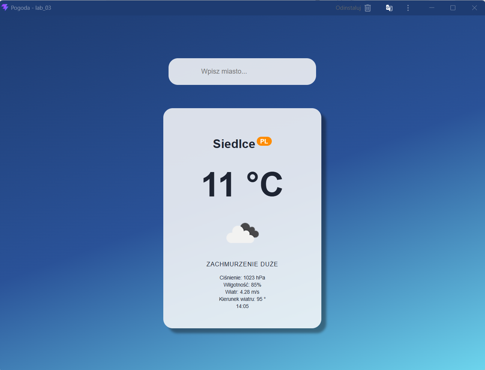
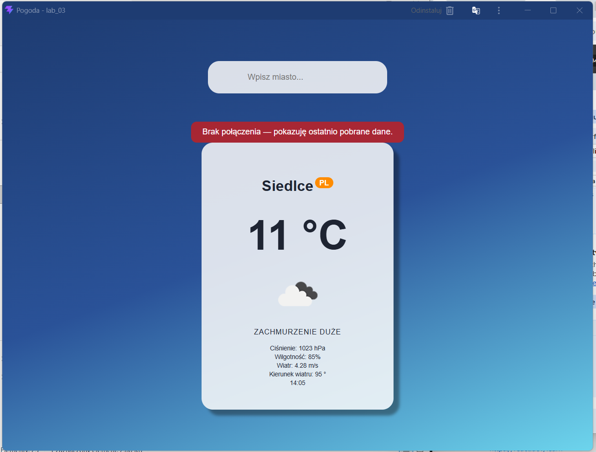

# Weather App — laboratorium 03

Prosta aplikacja pogodowa zbudowana w React. Pobiera bieżącą pogodę dla podanego miasta z OpenWeatherMap i jako PWA może wyświetlić ostatnio pobrane dane, gdy urządzenie jest offline.


## Uruchomienie

Wymagany jest Node.js 20.19 lub nowszy.

```bash
npm install
npm run dev
```

Aby zbudować i uruchomić wersję produkcyjną z obsługą PWA:

```bash
npm run build
npm run preview
```

Otwórz adres wyświetlony w terminalu. Tryb offline sprawdzaj w wersji produkcyjnej po wcześniejszym pobraniu pogody dla wybranego miasta.

## Zrzuty ekranu

### Pogoda online



### Aplikacja offline


